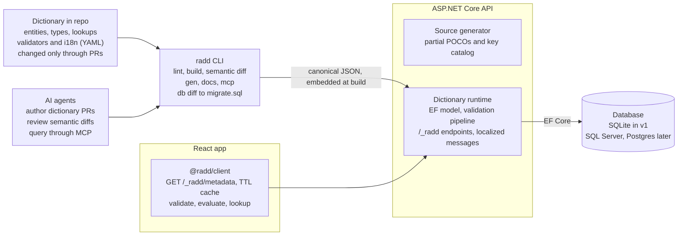

# RADD — Requirements Spec

Last updated: 2026-10-26 · Owner: Rommel

## Overview

One data dictionary, kept as files in the application's repo, defines every entity and field once. The database schema, API validation and front-end behavior are all driven from it. The framework is designed to be adopted by companies as part of an AI-first engineering approach, where AI agents author, review and query the dictionary alongside humans.

The first stack is React + TypeScript, C# / ASP.NET Core with EF Core, and SQLite. Java, Python and other backends, and SQL Server, Postgres and other databases, follow later without changing the dictionary format.

### Goals

1. **Single source of truth.** Length, nullability, read-only, labels, lookups, validation rules and messages are defined once and never re-typed in another layer.
2. **Defense in depth.** The API enforces every rule independently; the front end validates for user experience only and is never trusted.
3. **Native framework first.** Each runtime expresses the dictionary through its framework's own features (EF Core model configuration and migrations, ASP.NET Core validation and ProblemDetails) rather than a parallel engine.
4. **Repo-native.** Dictionary changes are plain-text diffs that go through PRs, review and CI like code.
5. **Stack-portable.** The dictionary format and its behavior are specified independently of any language, and every runtime proves conformance against a shared test suite.
6. **AI-first.** The dictionary is machine-readable, schema-checked and exposed to AI agents for authoring, review, coding context and natural-language questions.

### Non-goals for v1

- UI components. v1 is headless; a component library on MUI or Ant Design is a separate later project.
- Reverse-engineering a dictionary from an existing database.
- Field-level security and multi-tenant overrides.
- Backends and databases other than C# / EF Core and SQLite (the design must not block them).
- Sharing one dictionary across several systems or services; each dictionary serves exactly one system.

## Why RADD: the problems it solves

RADD comes from problems seen repeatedly across several companies. Each one maps to a specific part of the design, and each is a test RADD must pass.

| Problem seen in practice | How RADD addresses it |
| --- | --- |
| Validation is duplicated in the front end and the API, or missing or incomplete in one of them (the API assumes the front end validated, or the reverse) | Rules are defined once in the dictionary. The API always enforces every rule, at the boundary and again at save, whatever the client did. The client runs the same client-safe rules from the same metadata, and the conformance suite proves both give identical results. |
| Within the front end alone, a field used on several screens has its validation copied into each one | Rules belong to the field (`Customer.email`) or its domain type (`Email`), not to a screen. Every form asks `@radd/client` for that field's rules, so a change in the dictionary reaches every screen at once. |
| Tables and columns are undocumented; nobody can say what a table or column is for | Every entity and field must have a `description`, and lint fails without one. Tags mark personal and financial data. `radd docs` generates a browsable reference with ERDs, and DBML export is planned so the model can be viewed in standard tools. |
| Rewriting one layer means re-implementing all its validation from scratch | The rules live in the dictionary, not in any layer's code. A rewritten front end, API or database inherits them; a new runtime implements the published contract and passes the conformance suite, and CEL expressions run unchanged in every language. |
| Attempts to remove duplication are haphazard, one-off solutions | RADD is one standard approach: a schema-validated format, a published contract per runtime, a conformance suite, and ADRs recording every design decision, so each project does not reinvent its own. |

## Architecture



The CLI turns the repo's YAML into one canonical JSON document that the API embeds at build time; the API configures EF Core and serves client-safe metadata, which the React app caches.

| Package | Distribution | Role |
| --- | --- | --- |
| Dictionary JSON Schema | Published URL, versioned | Authoring validation in editors, CLI and agents |
| radd CLI | Node core (npm) plus stack plugins, see CLI | lint, build, diff, gen, db diff, docs, mcp |
| RADD.Generators | NuGet | Roslyn source generator for partial POCOs and key catalog |
| RADD.AspNetCore + RADD.EntityFrameworkCore | NuGet | Runtime: EF configuration, validation, `/_radd/*` endpoints, localization |
| @radd/client | npm | Headless TypeScript client |
| Conformance suite | Repo folder of test vectors | Proves every runtime behaves the same |

### Distribution

The framework ships as a single git repo for now, with NuGet and npm packages to follow.

- **Now:** projects consume the framework from the repo, through .NET project references and npm workspace or file links.
- **Later:** the .NET packages are published to NuGet and `@radd/client` to npm, under the same version number.
- **One-command start:** `radd init <name>` creates a working project with every layer:
  - a `/dictionary` folder with a sample entity, lookup and locale
  - an ASP.NET Core API wired to the runtime and EF Core with SQLite
  - a React + TypeScript app using `@radd/client`
  - AGENTS.md, CI lint and conformance steps
- `radd init` checks for the .NET SDK and Node first, then uses `dotnet new` and npm to install. Until packages are published, it points both at the git repo. The same command works unchanged once they move to NuGet and npm.

**Licensing:** the repo is public but not open source while the framework is in alpha. A `LICENSE` file states copyright, all rights reserved, alpha status and that no use is licensed. Companies that adopt it get separate written terms from the copyright holder. Outside pull requests require a contributor agreement first, so the license can change later. Moving to a source-available or open source license (for example PolyForm, Business Source License, MIT or Apache 2.0) is revisited at beta.

## Dictionary model

The dictionary is a folder of YAML files validated against a published JSON Schema. YAML is the authoring format because it diffs cleanly and is easy for both people and AI agents to write; tools load it into a canonical JSON form that every runtime consumes.

### Repository layout

```
/dictionary
  dictionary.yaml        # name, version, default locale, enabled databases
  types/                 # reusable domain types (Email, Money, MobileNumber)
  lookups/               # static lookup lists (gender.yaml, yes-no.yaml)
  entities/              # one file per entity (customer.yaml, order.yaml)
  validators.yaml        # named server validators: name, parameters, description
  calculators.yaml       # named server calculators for computed fields
  functions.yaml         # custom CEL functions: signature, client-safe or server-only
  i18n/                  # labels and messages per locale (en.yaml, fil.yaml)
```

One file per entity keeps PRs small and avoids merge conflicts. The CLI merges the folder into one canonical document with a content hash, which serves as the dictionary version.

### Logical types

Fields use logical types, never database types. Each database adapter maps them to native types.

| Logical type | Parameters | Example SQLite / SQL Server / Postgres mapping |
| --- | --- | --- |
| string | maxLength, minLength | TEXT / nvarchar(n) / varchar(n) |
| text | none | TEXT / nvarchar(max) / text |
| integer, long | min, max | INTEGER / int, bigint / integer, bigint |
| decimal | precision, scale | TEXT or REAL / decimal(p,s) / numeric(p,s) |
| boolean | none | INTEGER / bit / boolean |
| date, time, datetime, datetimeOffset | none | TEXT / date, time, datetime2, datetimeoffset / date, time, timestamp, timestamptz |
| guid | none | TEXT / uniqueidentifier / uuid |
| binary | maxLength | BLOB / varbinary / bytea |

Domain types in `types/` wrap a logical type with defaults and rules (an `Email` is a string of max 254 with an email format rule). Fields may override a domain type's settings but not its base type.

### Entity and field properties

| Property | Applies to | Layers enforcing it |
| --- | --- | --- |
| name, table, primaryKey, indexes, unique | entity | DB |
| type or domain type | field | DB, API, UI |
| required (nullability) | field | DB, API, UI |
| maxLength, minLength, precision, scale, min, max | field | DB (where native), API, UI |
| default (literal or expression) | field | DB, API, UI |
| readOnly: always, onUpdate (computed fields are always read-only) | field | API, UI |
| label, shortLabel, help, placeholder | field (via i18n keys) | UI |
| format and mask (email, url, phone, regex) | field | API, UI |
| lookup (static list, reference table, dependency) | field | DB (FK or check), API, UI |
| rules (conditional, cross-field, expression, named validator) | field, entity | API; UI for client-safe rules |
| relationships (one-to-many, many-to-one, many-to-many) | entity | DB, API |
| audit (createdAt/By, updatedAt/By), concurrency token, soft delete | entity | DB, API |

### Example

```yaml
# entities/customer.yaml
entity: Customer
table: customers
primaryKey: id
fields:
  id:          { type: guid, readOnly: always, default: newGuid() }
  name:        { type: string, maxLength: 120, required: true }
  email:       { domain: Email, required: true,
                 validators: [ { name: uniqueCustomerEmail, severity: error } ] }
  gender:      { type: string, maxLength: 1, lookup: { list: gender } }
  countryCode: { type: string, maxLength: 2, required: true,
                 lookup: { entity: Country, value: code, display: name, cache: static } }
  provinceId:  { type: integer,
                 lookup: { entity: Province, value: id, display: name, cache: ttl,
                           filter: "row.countryCode == countryCode", dependsOn: [countryCode] } }
  creditLimit: { type: decimal, precision: 12, scale: 2, min: 0 }
  vipNotes:    { type: text,
                 rules: [ { when: "creditLimit > 1000000.0", required: true,
                            severity: warning, message: customer.vipNotes.recommended } ] }
```

Labels and messages default to keys derived from the path (`customer.name.label`, `customer.name.required`) and are resolved from `i18n/`.

### Computed fields

A computed field declares where its value comes from with a `computed` block. Computed fields are always read-only, and the metadata endpoint exposes the source so a UI can show them correctly.

| Source | Declared as | .NET behavior | Database |
| --- | --- | --- | --- |
| database | `computed: { source: database, sql: { sqlite: ..., sqlserver: ..., postgres: ... }, stored: true }` | EF `HasComputedColumnSql(sql, stored)`; value read back after save | Computed column, stored or virtual; included in `radd db diff` |
| application, persisted | `computed: { source: application, expression: "dec.mul(quantity, unitPrice)", persisted: true }` | Evaluated by the runtime before validation on every save, then stored | Ordinary column |
| application, not persisted | `computed: { source: application, expression: ..., persisted: false }` | Evaluated on read; EF ignores the property | No column |
| application, server code | `computed: { source: application, calculator: orderTotal }` | A named calculator registered in DI, declared in `calculators.yaml` like named validators | Column if `persisted: true` |

- Expressions use the same portable expression language as validation rules, so the TypeScript client can show a live preview while a user edits; the API value is always authoritative.
- Database computations use SQL per provider because there is no portable form; the CLI fails if an enabled database has no SQL for a database-computed field.
- Values sent by a client for a computed field follow the same reject-or-ignore setting as other read-only fields.

```yaml
# entities/order-line.yaml (fields)
lineTotal:  { type: decimal, precision: 14, scale: 2,
              computed: { source: application, expression: "dec.mul(quantity, unitPrice)", persisted: true } }
searchName: { type: string, maxLength: 240,
              computed: { source: database, stored: true,
                          sql: { sqlite: "lower(name)", sqlserver: "LOWER([name])" } } }
```

## Validation model

Every rule has a kind, a severity, a message key and a place it runs. The API runs all rules on every write; the client runs only rules marked client-safe.

### Rule kinds

| Kind | Example | Runs on client | Runs on API |
| --- | --- | --- | --- |
| Basic constraint | required, maxLength 120, min 0, scale 2 | Yes | Yes |
| Format | email, url, regex `^09\d{9}$` | Yes | Yes |
| Lookup membership | gender must be in the gender list; provinceId must exist in Province for the chosen country | Static lists: yes. Reference tables: if cached | Yes, always |
| Conditional | vipNotes required when creditLimit > 1,000,000; readOnly when status is Closed | Yes | Yes |
| Cross-field | endDate >= startDate | Yes | Yes |
| Expression | any boolean CEL expression | Yes | Yes |
| Named server validator | uniqueCustomerEmail, creditCheck | No | Yes |

Conditional rules can switch `required`, `readOnly` and `visible` (a UI hint) on or off, so the same mechanism drives both validation and form state.

### Expression language: CEL

Conditions, cross-field rules and application-computed fields are written in CEL (Common Expression Language). It reads like code, is type-checked against declared field types at lint time, always terminates, and has an official conformance test corpus that every runtime can be measured against. JSONLogic was rejected for its loose semantics, lack of type checking and small set of built-in functions.

- **Variables:** the record's fields by name (`creditLimit > 1000000.0`); `row` for the candidate row in a lookup filter; `ctx` for server-supplied values such as `ctx.today` and `ctx.locale`, so client and server never disagree about the current time.
- **Declared subset:** `dictionary.yaml` lists the CEL extensions allowed (for example strings). Anything outside the subset fails `radd lint`.
- **Custom functions:** `functions.yaml` declares project-specific CEL functions (name, signature, description, client-safe or server-only). Each runtime implements them as a CEL extension, and the project's conformance vectors cover them. The framework ships a built-in set: `isBlank`, and decimal-safe `dec.add`, `dec.sub`, `dec.mul`, `dec.eq`, `dec.round`.
- **Decimals:** decimal fields can be compared directly, but arithmetic and equality on them must use the `dec.*` functions; lint warns on raw arithmetic over decimal fields.
- **Regex:** CEL uses RE2 syntax (no lookbehind or backreferences); lint validates every pattern.
- **Escape hatch:** anything that needs the database, business calendars, aggregates across records or complex decision logic is a named server validator or calculator, not an expression.
- **Libraries:** chosen in the spike by pass rate on the official cel-spec conformance corpus, support for custom functions, and type checking. Candidates: Celly or Cel.NET for .NET, `@marcbachmann/cel-js` for TypeScript.

### Named server validators

`validators.yaml` declares each validator's name, parameters and description. Each runtime registers an implementation by name (in .NET, a class implementing `IFieldValidator` or `IEntityValidator` registered in DI). Startup fails if a declared validator has no implementation, and the CLI fails if an entity references an undeclared one.

### Severity

| Severity | Meaning | Save behavior |
| --- | --- | --- |
| error | Data is invalid | Save is rejected |
| warning | Data is allowed but questionable | Save is rejected until the client resubmits with the warning codes acknowledged |
| info | Advisory only | Save proceeds; message returned |

### Result format

The API returns RFC 9457 ProblemDetails, extended with a list of results. The same shape is produced by the client-side validator, so UI code handles both identically.

```json
{
  "type": "urn:radd:problem:validation",
  "title": "Validation failed",
  "status": 422,
  "dictionaryVersion": "sha256:9f2c...",
  "results": [
    { "path": "email", "code": "customer.email.uniqueCustomerEmail",
      "severity": "error", "message": "This email is already registered.",
      "params": { "value": "a@b.com" } },
    { "path": "vipNotes", "code": "customer.vipNotes.recommended",
      "severity": "warning", "message": "Add notes for customers above 1,000,000 credit." }
  ]
}
```

Messages are resolved in the request's locale; `code` and `params` are always returned so a client can re-render in another locale.

## Lookups

Every lookup maps a stored value to a display value (M to Male, T to True, 42 to "Metro Manila"). Three sources are supported, and any of them can depend on another field.

### Static lists

Defined in `lookups/`, versioned with the dictionary. Each item has a code, a label key and optional sort order and active flag.

```yaml
# lookups/gender.yaml
lookup: gender
valueType: string
items:
  - { code: M, label: gender.male }
  - { code: F, label: gender.female }
  - { code: X, label: gender.unspecified, active: false }
```

Inactive items stay valid for existing data but are not offered for new values. The database enforces membership with a CHECK constraint where the adapter supports it; the API always enforces it.

### Reference tables

A field points at another entity, naming the value column and the display column. This creates a foreign key in the database.

| Property | Values | Meaning |
| --- | --- | --- |
| entity, value, display | entity and field names | What is stored and what is shown |
| cache | static, ttl, dynamic | static: loaded once per dictionary version; ttl: cached with an expiry (default from dictionary.yaml); dynamic: queried on every use |
| ttl | duration, e.g. 10m | Expiry when cache is ttl |
| filter | expression | Restricts the values offered and accepted (e.g. only active rows) |
| dependsOn | field names | Values are re-filtered when these fields change |
| search | true / false | Large tables are queried by type-ahead instead of loaded whole |

The API serves lookup values from a generic endpoint (`GET /_radd/lookups/{entity}.{field}?q=&depends=`) and applies the same filter when validating a write, so a client cannot submit a value outside the filtered set.

### Dependent lookups

A dependent lookup (country to province to city) declares `dependsOn` and a filter that references the parent field. When the parent changes, the client re-queries the child list, and the API rejects a child value that does not match its parent. Whether a stale child value is cleared automatically on the client is a client option, not a dictionary rule.

## Localization

All user-facing text (labels, help, placeholders, lookup labels, validation messages) lives in per-locale YAML files under `i18n/`, keyed by stable message keys. v1 ships with full support for multiple locales.

```yaml
# i18n/en.yaml
customer.name.label: Name
customer.email.uniqueCustomerEmail: This email is already registered.
gender.male: Male
# framework defaults, overridable per field
radd.required: "{label} is required."
radd.maxLength: "{label} must be at most {max} characters."
```

- Messages use ICU MessageFormat placeholders (`{label}`, `{max}`, plurals) so the same template renders in every runtime.
- Resolution order: field-specific key, then domain-type key, then framework default (`radd.required`).
- A missing key in the default locale fails the CLI lint; a missing key in another locale falls back to the default locale and is reported as a warning.
- The API picks the locale from `Accept-Language` (ASP.NET Core request localization); the client requests the metadata for one locale at a time.
- AI agents can draft translations for missing keys as a PR; a human approves them like any other change.

## Runtime behavior

The backend generates entity classes from the dictionary, then interprets the dictionary at runtime for everything else. The front end downloads the dictionary from the API at startup and caches it with a TTL.

### Generated entity classes (.NET)

- A Roslyn incremental source generator reads the dictionary (as MSBuild `AdditionalFiles`) and emits `partial` POCOs with properties and navigation properties only, no attributes. Generated code is never edited or checked in; developers add behavior in their own partial files.
- The same generator emits a strongly typed key catalog (`Radd.Customer.Email`) so application code never uses string field names.
- A CLI fallback (`radd gen csharp`) produces the same output for teams that prefer checked-in code.

### Startup and EF Core

- `builder.Services.AddDataDictionary()` loads the canonical dictionary, embedded in the assembly at build time, and fails fast if it is invalid or a named validator has no implementation.
- `modelBuilder.ApplyDataDictionary()` in `OnModelCreating` configures the EF model through the Fluent API: table names, keys, `IsRequired`, `HasMaxLength`, `HasPrecision`, defaults, indexes and unique constraints, check constraints for static lookups, relationships and foreign keys, concurrency tokens, and query filters for soft delete.
- Because the model is ordinary EF configuration, LINQ, change tracking, EF migrations and provider-specific behavior all work unchanged.

### Validation pipeline

- **At the API boundary:** an endpoint filter (minimal APIs) or action filter (controllers) validates the incoming payload against its entity and returns 422 ProblemDetails before any handler runs. Handling of read-only fields in the payload (reject or ignore) will be a dictionary setting; deferred past v1.
- **At save:** a `SaveChangesInterceptor` validates every added or modified entity, so background jobs and services that bypass the API are still covered.
- Both use one validation engine. Warnings block the save until the request includes the acknowledged codes (header `RADD-Acknowledge: customer.vipNotes.recommended`).
- Every response carries a `RADD-Version` header with the dictionary hash.

### Logging

The API logs through `Microsoft.Extensions.Logging` with structured message templates, so any provider (Serilog, OpenTelemetry, console JSON) receives named properties rather than formatted strings.

- **Structured:** source-generated `LoggerMessage` methods with stable event IDs and named properties (`{Entity}`, `{Path}`, `{Code}`, `{Severity}`, `{DictionaryVersion}`). A logging scope carries the trace ID, entity and dictionary version for every entry in a request.
- **Privacy:** values of fields tagged `pii` or `financial` are never logged; entries carry the path and code only.
- **Consistency:** the TypeScript client uses the same property names, so client and API logs can be correlated and queried together.

| Level | Used for |
| --- | --- |
| Trace | Per-rule evaluation detail (rule, inputs by path, outcome) |
| Debug | Metadata served, lookup cache hits and misses, EF model configuration detail |
| Information | Dictionary loaded (version hash); write rejected with 422 (entity, codes, severities); warnings acknowledged and saved |
| Warning | Validation failed in the SaveChanges interceptor after passing the API boundary (a bypass or a gap); missing translation fell back to the default locale; client sent a stale dictionary version |
| Error | A named validator or lookup query threw; an expression failed to evaluate at runtime |
| Critical | Dictionary invalid at startup or a declared validator has no implementation; the API refuses to start |

### Framework endpoints

| Endpoint | Purpose | Caching |
| --- | --- | --- |
| `GET /_radd/metadata?locale=en` | Full client-safe dictionary for one locale: entities, fields, rules, static lookups, messages | ETag = dictionary hash + locale |
| `GET /_radd/metadata/{entity}` | One entity, for large dictionaries | ETag |
| `GET /_radd/lookups/{entity}.{field}` | Reference-table values with `q` (search) and `depends` (parent values) | Per the field's cache mode |
| `POST /_radd/validate/{entity}` | Server-side validation without saving, including named validators | None |

Server-only details (named validator internals, server-only expressions) are never sent to the client. Application CRUD endpoints remain the developer's; the framework does not offer generic CRUD endpoints for now.

### Front-end client (TypeScript, headless)

The `@radd/client` package is framework-agnostic and has no UI.

- **Loading:** fetches `/_radd/metadata` at startup, caches it in memory and IndexedDB with a configurable TTL, and revalidates with the ETag. If any API response carries a `RADD-Version` different from the cached one, the client refreshes immediately, which handles deployments mid-session.
- **Field metadata:** `radd.entity('Customer').field('email')` returns type, required, maxLength, readOnly, label, help, lookup and rules.
- **Form state:** `radd.evaluate('Customer', values)` returns each field's current required, readOnly and visible state after conditional rules.
- **Validation:** `radd.validate('Customer', values)` returns results in the same shape as the API, using client-safe rules only.
- **Lookups:** `radd.lookup('Customer', 'provinceId', { depends, q })` honors static, TTL and dynamic cache modes.
- **Types:** `radd gen ts` optionally emits TypeScript interfaces and the key catalog for compile-time safety; the runtime behavior does not depend on them.

Thin adapters for form libraries (React Hook Form resolver, TanStack Form) can follow without changing the core.

**Logging:** the client logs every validation error and warning, from client-side validation and from API responses, through a logger interface supplied at setup. Teams plug in their logging library of choice; the default is a no-op. The client has no UI for errors or warnings: how users see and acknowledge them is decided by the future UI component layer.

## CLI

One command-line tool, `radd`, handles project setup, code generation, migrations and utilities for every stack. Its core is written in TypeScript on Node, and anything stack-specific is delegated to a plugin written in that stack's own language.

### Why this split

- **Node core:** the stack-neutral work (loading and linting the dictionary, the semantic diff, docs, the MCP server, interactive prompts) reuses the same TypeScript loader, JSON Schema and expression evaluator as `@radd/client`, so `radd validate` behaves exactly like the client. Node is already required for the React front end.
- **Stack plugins:** work that needs a framework's own tooling runs in that framework. The .NET plugin is a .NET tool that hosts EF Core for `db diff` and emits C#; Java and Python plugins later use Hibernate and SQLAlchemy the same way.
- **Protocol:** the core calls a plugin as an executable and exchanges JSON over stdin and stdout (canonical dictionary and options in, files and a report out), so plugins can be written in any language.

### Project config

`radd` reads `radd.config.yaml` at the project root. If it is missing, `radd init` asks the questions interactively and writes the file.

```yaml
name: acme-orders
dictionary: ./dictionary
frontend:  { stack: react-ts, path: ./web }
api:       { stack: dotnet, framework: aspnetcore, orm: efcore, path: ./api }
databases:
  - { name: local, provider: sqlite, connection: env:RADD_LOCAL_DB }
  - { name: staging, provider: sqlite, connection: env:RADD_STAGING_DB }
locales: { default: en, supported: [en, fil] }
```

Connection strings are always references to environment variables, never literal values, so the config file can be committed safely.

### Commands

| Command | What it does | Handled by |
| --- | --- | --- |
| `radd init [name]` | Creates a project with every layer from the config file, or asks questions and writes one | Core, then each stack's plugin |
| `radd db diff --target <name>` | Compares the dictionary with the named database and writes a timestamped SQL migration file plus a JSON change report | Database's API-stack plugin (.NET: EF Core) |
| `radd gen` | Regenerates checked-in generated code: TypeScript types and key catalog, C# fallback classes, docs | Core and plugins |
| `radd lint` | Validates the dictionary against the schema and conventions, type-checks expressions, checks translations | Core |
| `radd build` | Writes the canonical JSON and its hash | Core |
| `radd diff --base <ref>` | Semantic diff between two versions of the dictionary | Core |
| `radd validate <entity> <file>` | Validates a sample record with client-safe rules, or all rules through the plugin | Core and plugin |
| `radd docs` | Generates the reference site with ERDs | Core |
| `radd mcp` | Runs the MCP server for AI agents | Core |
| `radd doctor` | Checks prerequisites (.NET SDK, Node), plugin and package versions, config validity | Core |

### Behavior every command follows

- Every interactive question has a matching flag, and `--yes` accepts defaults, so CI pipelines and AI agents can run any command without prompts.
- Every command supports `--json` output and exits non-zero on failure.
- No command changes a database; `db diff` only writes files.
- Distributed through npm (`npx radd`) for now from the git repo; plugins install through their own ecosystem (`dotnet tool` for .NET).

## Database and migrations

v1 generates a reviewable SQL migration script by comparing the dictionary with a live target database. Normal EF Core migrations keep working alongside it, because the EF model is built from the same dictionary.

### Two workflows

| Workflow | Command | When to use |
| --- | --- | --- |
| EF migrations | `dotnet ef migrations add <Name>` | Teams that already version migrations in code; compares against the EF model snapshot |
| Dictionary-to-database diff | `radd db diff --provider sqlite --connection "..." --out migrate.sql` | Any environment whose actual state is unknown or has drifted; compares against the real database |

### How the diff works in .NET

1. Build the desired relational model by running `ApplyDataDictionary()` on an EF model builder.
2. Read the target database's actual schema with EF Core's scaffolding services (the same reverse-engineering used by `dotnet ef dbcontext scaffold`) and turn it into a relational model.
3. Compare the two with EF's migrations model differ, producing migration operations.
4. Render the operations as SQL with the provider's migrations SQL generator. SQLite table rebuilds for unsupported ALTERs are handled by the EF SQLite provider.

Some of these EF services are internal APIs and the differ was designed for model-to-model comparison, so a spike must confirm the output is clean (no spurious changes from naming or default-value differences). If it is not, the fallback is a dedicated schema-diff step that still emits SQL through EF's SQL generators.

### Safety rules

- **Scope:** only tables and columns owned by the dictionary are compared by default; unknown objects are listed but never dropped.
- **Renames:** fields and entities declare `renamedFrom`, so a rename becomes a rename instead of drop-and-add.
- **Classification:** every operation is tagged safe, needs-data-check or destructive in a JSON change report written next to the script.
- **Data checks:** tightening changes (shorter maxLength, nullable to required, new unique index, new check constraint) include generated pre-check queries that count violating rows.
- **Destructive changes:** dropping a column or table, or narrowing a type, is excluded from the script unless `--allow-destructive` is passed.
- **No auto-apply:** the tool writes a script; applying it is a separate, explicit step owned by the team's deployment process.

## AI-first capabilities

AI agents work on the dictionary through the same CLI and schema as people, with deterministic checks as guardrails and humans approving every change. All four modes are in scope.

### Foundations

- Every field and entity has a required `description` and optional `tags` (pii, financial, audit). Descriptions are what make the dictionary useful to agents, so lint enforces them.
- `/dictionary/AGENTS.md` states the naming conventions, domain-type catalog and change rules in plain language.
- Every CLI command supports `--json` output so agents can act on results without parsing text.

### The four modes

| Mode | How it works | Guardrails |
| --- | --- | --- |
| AI authors entries | An agent turns a spec or ticket into YAML changes, runs `radd lint` and `radd db diff`, and opens a PR with the change report attached | Lint must pass; agents can never pass `--allow-destructive`; a human merges |
| Context for coding agents | `radd mcp` runs an MCP server with tools such as list_entities, get_entity, find_fields (by name, description or tag), get_rules, validate_sample and lookup_values | Read-only; serves the dictionary at the commit being worked on |
| AI reviews changes | `radd diff --base main --json` produces a semantic diff (fields added, types changed, rules tightened, breaking API changes, migration classification, missing translations). CI runs the deterministic checks; a review agent adds judgment on naming, consistency with similar fields and missing rules, and comments on the PR | The deterministic checks block; the agent only comments |
| Natural-language queries | The MCP server plus `radd docs`, which generates a browsable reference with Mermaid ERDs, answer questions like "which fields hold personal data?" or "what depends on Country?" | Answers cite entity and field names so they can be checked |

The semantic diff and the change report are the key artifacts: they let both CI and agents reason about a dictionary change without reading raw YAML diffs.

## Multi-stack portability

A shared conformance suite, not shared code, is what keeps future backends and databases consistent with the C# reference implementation.

### What every runtime must implement

| Contract | Defined by | Example native mapping |
| --- | --- | --- |
| Dictionary loading | JSON Schema + canonical JSON | Embedded resource (.NET), classpath resource (Java), package data (Python) |
| ORM model configuration | Field and entity properties | EF Core Fluent API; Hibernate metadata for Java; SQLAlchemy for Python |
| Validation engine and result format | Rule kinds, severity, ProblemDetails shape | ASP.NET endpoint filter; Spring validator; FastAPI dependency |
| Expression evaluation | CEL, plus the project's custom functions | That language's CEL library for the stack |
| Framework endpoints | `/_radd/*` contract, published as OpenAPI | Native routing in each framework |
| Named validator registry | `validators.yaml` | DI registration by name |

### Conformance suite

- A language-neutral folder of test vectors: a dictionary, an input record, and the expected results (codes, severities, paths, resolved messages per locale).
- Separate vectors cover expression evaluation, conditional state (required, readOnly, visible) and lookup filtering.
- Schema vectors give a dictionary and, per database, the expected DDL after a diff against a known starting schema.
- The TypeScript client and the .NET runtime both run the suite in CI from v1; a new backend or database adapter ships only when it passes.

### Database adapters

Each database adapter supplies the logical-type mapping, constraint support (check constraints, filtered indexes) and the schema reader and SQL generator used by `radd db diff`. In .NET, these come from the EF Core provider for that database, so SQL Server and Postgres support is mostly a type-mapping table plus conformance runs.

## Roadmap

Spikes come first because each can change the design; the build phases follow. The detailed, staged version is in [implementation-plan.md](implementation-plan.md).

1. **Spikes:** CEL library selection for .NET and TypeScript (official conformance corpus pass rate, custom functions, type checking); dictionary-to-database diff using EF scaffolding, model differ and SQL generator on SQLite; Roslyn source generator for partial POCOs.
2. **Core:** JSON Schema, CLI (`lint`, canonical build with hash, semantic `diff`), conformance suite skeleton.
3. **.NET runtime:** source generator, `ApplyDataDictionary()`, validation pipeline (endpoint filter + SaveChanges interceptor), named validators, `/_radd/*` endpoints, localization, SQLite.
4. **TypeScript client:** loading and TTL cache, field metadata, conditional state, validation, lookups, optional type generation.
5. **Migrations:** `radd db diff` with change report, data checks and destructive-change gating.
6. **AI layer:** MCP server, `radd docs` with ERDs, AGENTS.md, PR review workflow.

After v1: the UI component project (MUI or Ant Design), DBML export (`radd gen dbml`), SQL Server and Postgres adapters, Java and Python runtimes, reverse-engineering existing databases, field-level security, multi-tenancy.

## Decisions

All open questions from the requirements discussion are decided. Each becomes an ADR in `docs/adr/` during stage 1.

- **Expression language:** CEL, with a declared subset, project-defined custom functions, and named server validators as the escape hatch. The stage 2 spike picks the .NET and TypeScript libraries.
- **CLI:** a Node/TypeScript core with stack plugins in each stack's own language (see CLI).
- **Read-only fields in a write payload:** deferred past v1; whether they are rejected (422) or ignored will be configurable in the dictionary.
- **Warnings and errors on the client:** the client logs all errors and warnings through a pluggable logger. How users see and acknowledge them is left to the future UI component layer.
- **Logging:** structured, at the API and the client, with consistent property names and the log-level usage in the Logging table.
- **Generic CRUD endpoints:** none for now; application endpoints stay the developer's.
- **Computed fields:** both database and application computation, declared explicitly in the dictionary (see Computed fields).
- **Sharing:** each dictionary serves exactly one system. Sharing across services is out of scope.
- **Hot reload:** none for now. Dictionary changes take effect on rebuild and restart (`dotnet watch` covers this in development).
- **Distribution:** a git repo for now, NuGet and npm packages later, and a single-command project initializer (see Distribution).
- **Licensing:** public repo, all rights reserved, not open source while in alpha (see Distribution).
- **Naming:** the framework is RADD; the CLI is `radd`; packages are `RADD.*` on NuGet and `@radd/*` on npm; endpoints are `/_radd/*`; headers are `RADD-Version` and `RADD-Acknowledge`.
